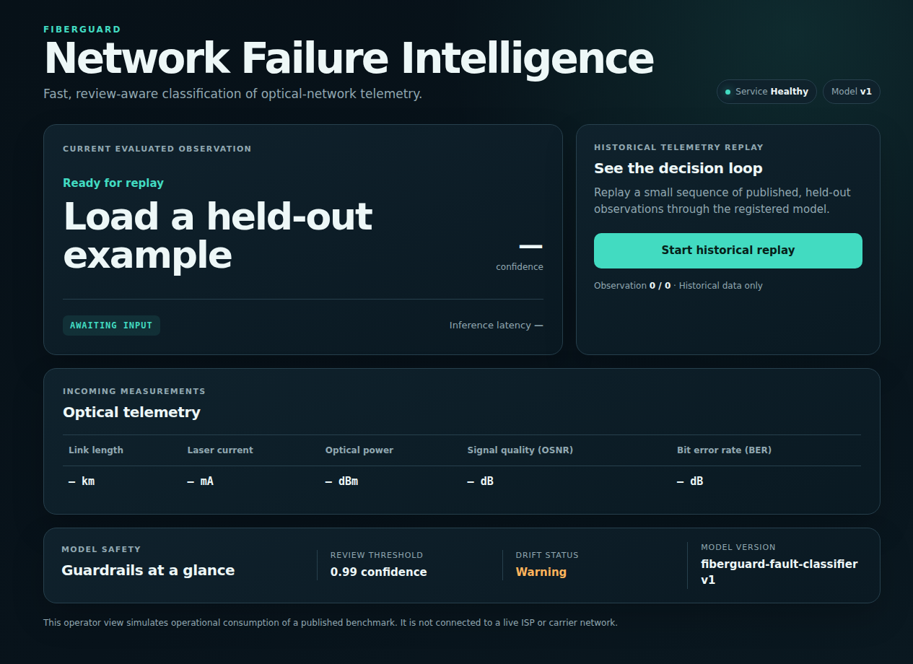

# FiberGuard

Spotting faults in optical fibre links from their telemetry, and knowing when to ask a human.

Optical networks report five measurements per link: link length, laser current,
optical power, signal quality (OSNR) and bit error rate. FiberGuard reads those
and predicts one of four states:

- **healthy**
- **laser degradation** (ECL)
- **amplifier degradation** (EDFA)
- **nonlinear impairment** (NLI)

When the model is less than 99% confident, it doesn't guess. It sends the case
to a human.



> **Scope:** trained and evaluated on a published optical-network telemetry
> dataset (3.6M rows, 756 links). The replay and drift loop simulates how an
> operator would use it; it is not connected to a live carrier network.

## Results (final test set, links never seen in training)

| Model | Macro-F1 |
|:--|--:|
| Always guess the same class | 0.100 |
| Logistic regression | 0.990 |
| **XGBoost** | **0.997** |

A simple model already does well, which tells you the task is learnable from
these five signals. XGBoost adds a small, real improvement, so I stopped there.
No deep learning was needed.

**Human review:** at a 0.99 confidence threshold, 718 of 136,800 test cases
(0.52%) go to review. Those include 267 of the model's 441 mistakes (61%).
The predictions it keeps are 99.87% accurate.

## The key decision: split by link, not by row

The dataset has no link ID column. But readings from the same link are nearly
identical, so a random row split would put the same link in both training and
testing, and the score would look better than it really is.

I rebuilt the link identity from the order the publisher wrote the data in,
checked that the structure holds for all 756 links, and then split whole links
into train, validation and test. No link appears in more than one split.

## Checks I ran

- **Feature ablation:** dropping laser current takes macro-F1 from 0.997 to
  0.747; dropping optical power takes it to 0.868. No single signal explains
  the result.
- **Calibration:** I tried sigmoid calibration on the validation set. It made
  log loss and Brier score worse, so I kept the raw XGBoost probabilities.
- **Review threshold:** picked on validation data only. I aimed to catch 75% of
  validation errors with at most 5% of cases reviewed; the best threshold under
  that cap caught 55% on validation and 61% on test.
- **Drift:** a PSI check compares incoming telemetry against the training data.
  It flags the publisher's own test data as shifted (optical-power PSI 2.72,
  warning threshold 0.20), which is a real difference between the dataset's
  train and test files, not a bug.

## How it runs

- **MLflow** tracks and registers the model (`fiberguard-fault-classifier` v1).
- **FastAPI** serves `GET /health` and `POST /predict`, returning the state,
  confidence, whether it needs review, model version and latency.
- **Replay:** a fixed held-out sample runs through the same prediction path
  (about 0.27 ms p50, 0.76 ms p95, in-process).
- **Operator view** at `GET /` shows model health, the latest reading, the
  likely fault, confidence, review routing and drift.

Every number above is saved in `artifacts/` (data audit, split manifest,
baselines, calibration, ablation, drift).

## Not in scope

- No live carrier data: the interface replays historical readings.
- No Kafka or Kubernetes: a bounded replay is enough for this version.

## Reproduce

Place the two dataset files under `data/raw/Optical network soft failure dataset/`:
`Lightpath_756_label_4_QoT_dataset_train_900.txt` and
`Lightpath_756_label_4_QoT_dataset_test_300.txt`. The dataset's bundled
metadata gives the four-state labels but no verified author list, DOI or
canonical URL.

```bash
python3 -m venv .venv
source .venv/bin/activate
pip install -e .

# Rebuild audits, evaluation and the registered model
PYTHONPATH=src python3 scripts/audit_data.py
PYTHONPATH=src python3 scripts/train_baselines.py
PYTHONPATH=src python3 scripts/evaluate_reliability.py
PYTHONPATH=src python3 scripts/productionize.py

# Run the service, replay and drift check
PYTHONPATH=src uvicorn fiberguard.api:app --host 127.0.0.1 --port 8000
PYTHONPATH=src python3 scripts/replay_telemetry.py
PYTHONPATH=src python3 scripts/validate_drift.py

# Tests
PYTHONPATH=src python3 -m unittest discover -s tests
```

Open `http://127.0.0.1:8000/` for the operator view.
